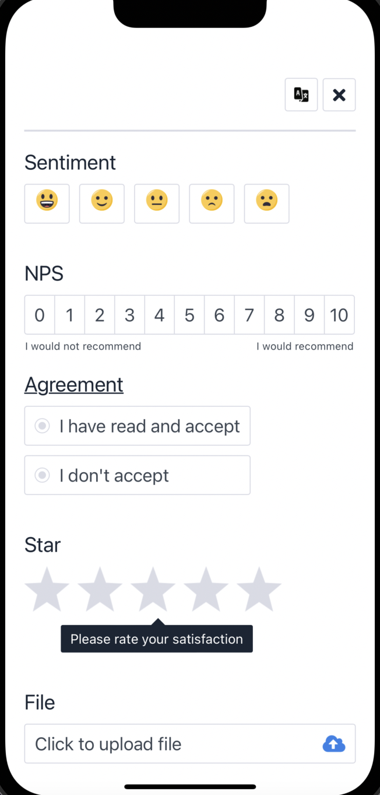
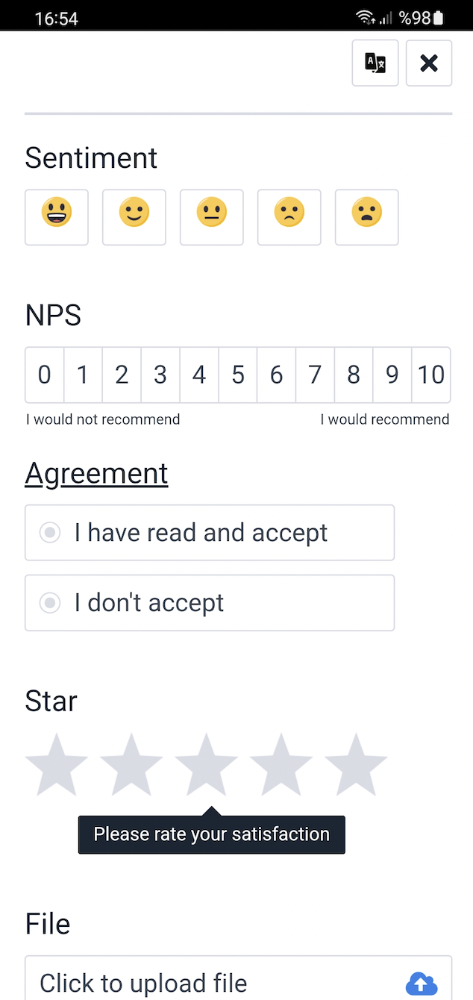

# Pisano Feedback Flutter SDK

Flutter plugin that bridges Pisano native SDKs on **Android** and **iOS**.

If you’re looking for the native iOS sample apps, see the Pisano iOS sample repo and its guide: [Pisano iOS sample apps README](https://github.com/Pisano/feedback-sample-ios-app/blob/main/README.md).

## ✨ Features

- **Widget UI**: Feedback widget is rendered via web content through the native SDKs
- **One Flutter API**: Same Dart calls for Android + iOS (`init`, `show`, `healthCheck`, `track`, `clear`)
- **Survey events**: `events` stream with opened / submitted / store redirect / closed (with the reason)
- **View modes**: Full screen and bottom sheet
- **Customer + payload**: Pass customer attributes and transactional payload
- **Multi-language**: Provide `language`
- **Custom title**: Provide `title` + `titleFontSize`

## 📱 Requirements

- **Flutter**: tested with Flutter `3.38.3` (Dart `3.10.1`)
- **iOS**: **iOS 15.0+** (native Pisano SDK 2.0); Xcode 16+, CocoaPods `>= 1.13` or Swift Package Manager
- **Dart**: `>= 2.17`
- **Android development**: Android SDK 34+ and Java 17

Native SDK versions are an internal implementation detail for most consumers.
If you are contributing to the plugin or debugging native builds, see `DEVELOPMENT.md`.

## 📦 Installation

### Option A) Git dependency (most common for private distribution)

In your app’s `pubspec.yaml`:

```yaml
dependencies:
  feedback_flutter_sdk:
    git:
      url: https://github.com/Pisano/feedback-flutter-sdk.git
      ref: <tag_or_commit>
```

### Option B) Local path (during development)

```yaml
dependencies:
  feedback_flutter_sdk:
    path: ../feedback-flutter-sdk
```

Then run:

```bash
flutter pub get
```

## 🚀 Quick Start (Flutter)

### 1) Import

```dart
import 'package:feedback_flutter_sdk/feedback_flutter_sdk.dart';
```

### 2) Initialize (Boot)

Call once at app startup (or before the first `show()`):

```dart
final feedbackSdk = FeedbackFlutterSdk();

final booted = await feedbackSdk.init(
  '<applicationId>',
  '<accessKey>',
  '<apiUrl>',
  '<feedbackUrl>',
  null, // eventUrl (optional)
  debugLogging: false,
  code: '<surveyOrChannelCode>', // required; from Pisano panel
);
if (!booted) {
  // Boot failed — show() will complete with FeedbackCallback.none.
}
```

### 3) Show widget

```dart
final result = await feedbackSdk.show(
  viewMode: ViewMode.bottomSheetMode,
  title: 'We Value Your Feedback',
  titleFontSize: 20,
  code: null, // optional; if omitted, boot code is used
  language: 'tr',
  dismissOnDrag: true, // bottom sheet: let the user drag it away
  customer: const PisanoCustomer(
    name: 'John Doe',
    externalId: 'CRM-12345',
    email: 'john@example.com',
    phoneNumber: '+905001112233',
    customAttributes: {'plan': 'premium'},
  ),
  payload: {'source': 'app', 'screen': 'home'},
);

if (result == FeedbackCallback.sendFeedback) {
  // The survey was submitted.
}
```

### 4) Listen to survey events (optional)

```dart
final subscription = feedbackSdk.events.listen((event) {
  switch (event.type) {
    case PisanoEventType.feedbackSubmitted:
      print('submitted, chat: ${event.hasChat}');
      break;
    case PisanoEventType.closed:
      print('closed: ${event.closeReason}');
      break;
    default:
      break;
  }
});

// Later:
await subscription.cancel();
```

### 5) Track event

```dart
final sent = await feedbackSdk.track(
  'view_promo',
  language: 'tr',
  customer: const PisanoCustomer(externalId: 'CRM-12345'),
  payload: {'campaign': 'winter'},
);
```

### 6) Clear

```dart
await feedbackSdk.clear();
```

## 📚 API Reference

### `FeedbackFlutterSdk`

- **`Future<bool> init(applicationId, accessKey, apiUrl, feedbackUrl, eventUrl, {debugLogging, required code})`**
  - Must be called before `show` / `track`. `code` is the survey/channel code from the Pisano panel.
  - Completes with `true` once the SDK is set up, `false` when it failed (wrong credentials or URL, network error).
- **`Future<FeedbackCallback> show({viewMode, title, titleFontSize, code, language, customer, payload, dismissOnDrag})`**
  - Completes **once** with the result (see [`FeedbackCallback`](#feedbackcallback)).
  - `code` is optional; if omitted, the boot code is used.
  - `dismissOnDrag` (bottom sheet only, default `false`) lets the user drag the sheet away.
- **`Future<bool> healthCheck({code, language, customer, payload})`**
  - Whether `show()` would open a survey right now, without showing anything.
- **`Future<bool> track(event, {language, customer, payload})`**
  - Sends a custom event to the trigger engine; completes with `true` when the server accepted it (`false`: not initialized, no `eventUrl`, no connection, or the request failed). A survey it triggers opens on its own and reports through `events`.
- **`Stream<PisanoEvent> events`** — see [Survey events](#pisanoevent--survey-events).
- **`Future<void> setAutomaticStoreReview(bool enabled)`**
  - Whether the SDK asks the system for the store review prompt when a survey redirects to the store. Defaults to `true` (again on every app start). Turn it off to run your own flow on the `redirectedToStore` event (`handledBySDK` is `false`). The `show()` result does not change.
- **`Future<void> setRequestTimeout(Duration timeout)`**
  - Network timeout of every SDK request, in whole seconds: a request fails when the server sends no data for this long. Defaults to 30 seconds on both platforms; applies to requests that start after it is set. Less than 1 second is ignored.
- **`Future<void> clear()`**
  - Ends the session; a `show()` still pending completes with `FeedbackCallback.none`.

### `ViewMode`

- **`ViewMode.defaultMode`**: full screen
- **`ViewMode.bottomSheetMode`**: bottom sheet

### `FeedbackCallback`

The result of `show()`, reported once:

| Value | When |
|---|---|
| `sendFeedback` | The survey was submitted — also in chat surveys, and also when the thank-you screen is closed early |
| `closed` | Closed without submitting: close button, back (Android), drag, a tap outside the bottom sheet, or the app/system took it away. The `closed` event's `closeReason` tells which |
| `none` | No result: not initialized, no connection, a failed request, the survey page could not load, `clear()` was called, or a second `show()` while one is open |
| `displayOnce` | Not shown: the customer saw it before |
| `preventMultipleFeedback` | Not shown: the customer already gave feedback in the given period |
| `channelQuotaExceeded` | Not shown: the channel quota is full |
| `channelPassive` | Not shown: the channel is passive |
| `displayRateLimited` | Not shown: display rate limit |

A store review request is not a result: it is the `redirectedToStore` event.

### `PisanoEvent` — survey events

`feedbackSdk.events` is a broadcast stream of the events of every survey shown by `show()`:

| `type` | When | Extra field |
|---|---|---|
| `opened` | the survey widget is on screen | — |
| `feedbackSubmitted` | the user submitted the survey (also in chat surveys) | `hasChat` |
| `redirectedToStore` | the survey asked for the store review flow | `handledBySDK`: the SDK asked the system for the review prompt (the system does not say whether it was shown) |
| `closed` | the widget left the screen, right before the `show()` result | `closeReason` |

`PisanoCloseReason`: `closeButton`, `back` (Android), `drag`, `outside`, `afterSubmit` (the thank-you screen ended), `clear`, `loadFailed`, `hostDismissed` (the app or the system took the widget away).

For one survey the events arrive in this order, all before the `show()` result: `opened` → `feedbackSubmitted` → `redirectedToStore` → `closed`. A survey that is not shown sends no events. A widget that closes before it finished appearing (a page that cannot load) may send `closed` without `opened`. Every event carries the survey `code`.

### `PisanoCustomer`

`name`, `email`, `phoneNumber`, `externalId`, `customAttributes` — the same fields as the native SDKs. `customer` also accepts a `Map`: other spellings (`phone_number`, `external_id`, `custom_attrs`, `phone`, any case) are mapped onto these fields, the canonical spelling wins when two keys name the same field, and an unknown key is **not sent** and logs a warning.

## ▶️ Run the Example App

The `example/` app uses the plugin through a path dependency and shows a UI similar to Pisano’s native sample flows.

### 1) Install dependencies

```bash
flutter pub get
(cd example && flutter pub get)
```

### 2) Provide credentials (local-only)

See `example/README.md` for the recommended approach (local `pisano_defines.json` ignored by git).

### 3) Run

```bash
cd example
flutter run -d <device_id>
```

## ⚙️ Platform Configuration Notes

### iOS permissions (only if your flows use attachments)

Add to your app’s `Info.plist`:

- `NSCameraUsageDescription`
- `NSPhotoLibraryUsageDescription`
- `NSPhotoLibraryAddUsageDescription`

These are the same requirements described in the iOS native sample guide: [Pisano iOS sample apps README](https://github.com/Pisano/feedback-sample-ios-app/blob/main/README.md).

### Android permissions

This plugin’s Android manifest includes network permissions (e.g. `INTERNET`). If your flow uses additional device features, ensure your app requests the corresponding permissions.

## ❓ Troubleshooting

### “SDK not initialized / boot not happening”

- Ensure you call `await feedbackSdk.init(...)` before `show()` or `track()`
- Ensure credentials/URLs are not empty
- In the `example/` app: provide credentials as described in `example/README.md`

### iOS build issues

- Run once inside `example/ios`:

```bash
cd example/ios
pod install
```

### Android dependency resolution issues

- Ensure Gradle can reach `mavenCentral()` and the Android SDK is installed

## ✅ Smoke Tests / Checks

From repo root:

```bash
flutter analyze
flutter test
(cd example && flutter analyze)
```

## 📷 Screenshots

iOS              |  Android 
:-------------------------:|:-------------------------:
  |  

## Licence

Copyright Pisano.

Released under the MIT license. See [LICENSE](https://github.com/Pisano/feedback-flutter-sdk/blob/main/LICENSE).
